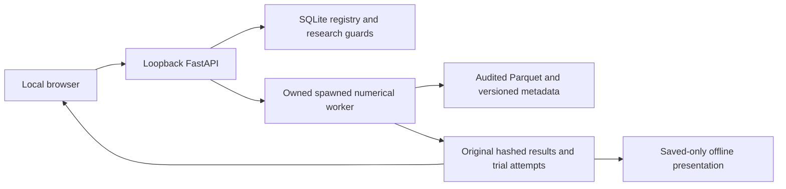

# Development Journey — Price Action Research Lab

**A video-inspired strategy-testing application, still in development.**

**Project period covered:** November7–9,2026, Pacific time. Exact accounting cutoff: **2026-11-09T18:36:32.512Z**, when this journey was requested. Writing this document is excluded from the build totals.

**Deliverable:** the private application at [http://127.0.0.1:8767](http://127.0.0.1:8767), its [implementation plan](PLAN.md), [numerical rulebook](RULEBOOK.md), [verification plan](VERIFICATION_PLAN.md), and retained local evidence. A localhost URL works only while the owner’s server is running; it is not a public deployment.

**Source:** [Claude Tested100,000 Price Action Strategies (Here’s What Works), AI Pathways](https://www.youtube.com/watch?v=z97PnFIPoFg). The downloaded metadata reports an October28,2026 upload. The project used the video and its visible prompt pages, not the host’s private engine, historical trade files or unpublished recipes.

**Status at the cutoff:** version0.25 was integrated and running. D046 trade-twin matching and original entry traces were verified in an isolated source copy. The financial twin simulator, its durable API/UI workflow and the remaining research funnel were unfinished. **This is a development history, not a completion certificate.**

This account is reconstructed from the owning Codex rollout’s public messages and structured usage records, the decision log, source documents,941 execution receipts and selected original artifacts. Earlier work is therefore a documented reconstruction, not a claim of perfect recall. Hidden reasoning, credentials, raw private browser traces, cached prices and databases are not reproduced. The source video’s transcript and prompt deck are not republished.

## 1. The brief and the decisions the user actually made

The initial request was:

> build me the same application for testing price action strategies as described in this video. you must capture the details by examining the video frame by frame. let me know what the gaps are and any requirements or dependencies. come up with a plan first. AMIAQ

“AMIAQ” was interpreted as permission to ask questions. Investigation and planning came first. The user then settled the important product boundaries: **US stocks and ETFs first; a private localhost web app; free data initially; a free Alpaca account; and both long and short simulations with explicit borrowing assumptions.** Futures, forex and crypto were retained as later options.

The user explicitly rejected being asked to choose unfamiliar trading jargon: “i am not an expert in this domain. i do not know the language and the tradeoffs. i just want an accurate and reliable testing system.” That changed the design burden. The software had to make its assumptions inspectable instead of relying on the user to notice hidden execution or statistical choices.

The authorization progressed from planning to “complete the project.” The user then asked for an updated plan naming the YouTube source and every known difference from the host’s implementation. When asked whether the strategies were the same, the answer distinguished the same ten strategy families from identical detector definitions or trades. That distinction remained binding.

The decisive verification instruction was:

> the implementation plan should include an exhaustive verification plan, providing evidence all use cases are tested and verified. receipts and evidence should be provided for during the implementation and verification processes.

This led to a formal acceptance catalog rather than a loose checklist. “Exhaustive” was defined as coverage of every declared use case, supported option, boundary and failure path, with systematic combinations. It was never presented as a mathematical proof over every possible market history.

The user also supplied the local Alpaca credential configuration and added its secret key when the bounded access probe required it. Values stayed out of the documentation. The later server-cleanup episode required several unwanted manual actions; that failure is described in section6 rather than hidden behind the eventual fix.

## 2. Work-clock time, token consumption and money

### 2.1 Three different clocks

The user estimated “over one day,15 hours and17 minutes.” The measured records support that lower bound.

| Measurement | Time | What it measures |
|---|---:|---|
| Full project-chat span | **1 day18 hours03 minutes40 seconds** | Thread creation at2026-11-08T00:32:52.534Z to the documentation request |
| Union of35 completed/aborted assistant work-turn intervals | **1 day17 hours02 minutes30 seconds** | Recorded turn intervals, without adding overlapping time twice |
| Active-goal counter observed at2026-11-09T18:36:39Z | **1 day15 hours41 minutes14 seconds** | The implementation goal, created after initial investigation/planning |

The first clock is42:03:40; the second is41:02:30; the third is39:41:14. They are alternative views, not quantities to add. The full span began at November7,16:32:52 Pacific time and ended at November9,10:36:32 Pacific time.

These are **wall-clock measurements**. They include tool execution, test waits and, where applicable, machine standby. They are not CPU time, uninterrupted model generation, human keyboard time or billable person-hours. Adding all receipt durations would be misleading because checks sometimes ran concurrently. The goal counter also omits the earlier investigation and planning period.

The exact elapsed span is151,419.978 seconds. The interval-union calculation is147,749.941 seconds. The goal observation is preserved separately because it was read about seven seconds after the frozen build cutoff. [Clock method and per-turn accounting](docs/development-journey/WORK-CLOCK-AND-TOKENS.md).

### 2.2 Entire-project token accounting

The audit summed **2,818 individual response-usage records**, once per response identity. There were zero duplicate response IDs. The result exactly equals the final cumulative thread-usage record before this documentation request. This is stronger evidence than estimating tokens from source-file size or quoting a smaller dashboard counter.

| Category | Recorded tokens | Relationship |
|---|---:|---|
| All input | **640,077,823** | Includes cached input |
| Cached input | **635,467,136** | A subset of input |
| Uncached input | **4,610,687** | All input minus cached input |
| All output | **3,835,647** | Includes reasoning output |
| Reasoning output | **2,216,009** | A subset of output |
| Input plus output | **643,913,470** | Full total, including cached context |
| Uncached input plus output | **8,446,334** | A useful separate measure of uncached input and generation |

Cached tokens must not be added to input a second time. Reasoning tokens must not be added to output a second time. The643.91-million figure does **not** mean that643.91 million new words/tokens were written for the project. Most of that total is repeated cached context supplied to successive requests.

An early documentation-time goal query showed **7,993,870 tokens**. That observation had a narrower start/scope than the full response ledger. It is retained as an observation, not substituted for the entire-project total and not added to it. The rollout also contains17 compaction records, illustrating how long-running context management became part of the process.

The recorded model identifier in53 turn-context records was `gpt-6.1-sol`. This is the identifier actually present in the local record; it is not an assertion about a public API SKU or its price.

### 2.3 Dollar cost: unavailable, not zero

**The exact monetary charge cannot be established from the available project records.** They contain token usage, not an attributable project invoice, subscription allocation or credit-debit ledger. The shared account’s usage percentages would not establish this project’s dollar bill. No unrelated model’s public API price has been substituted.

If uniform API-style rates in dollars per million were actually applicable, the arithmetic would be:

```text
4.610687 × uncached-input rate
+635.467136 × cached-input rate
+3.835647 × output rate
```

That is an accounting formula, **not a quoted cost**. Context tiers, discounts and Codex subscription/credit terms can require different treatment. Cached input is not assumed free. Exact monetary accounting needs the applicable account billing evidence.

The application itself has no paid runtime AI dependency or live-order capability. Initial market-data work used the agreed free Alpaca access. This does not turn development-model usage, hardware, electricity or storage into a measured zero-dollar project.

The machine-readable snapshot is [ACCOUNTING.json](docs/development-journey/ACCOUNTING.json). Its cutoff deliberately excludes the cost of writing this retrospective, which continued after the build snapshot.

## 3. The development chronology

All detailed timeline timestamps below are UTC. Pacific dates in the title span the preceding local evenings as well.

### 3.1 Investigation: the visible product was a presentation, not a usable research application

The first discovery changed the project’s interpretation. The video showed a dark, slide-like results dashboard and described the machinery behind it. It did not demonstrate a complete interactive application for importing data, configuring rules, managing durable jobs or auditing individual results. Reproducing its appearance alone would have left the user without a working testing system.

The video was acquired locally at4K, with a1080p review representation. The review representation contained **30,920 frames at30fps** and lasted1030.666667 seconds. Every frame was decoded during automated scene-change analysis. Visual inspection used **1,031 one-second samples across21 contact sheets**, denser half-second sampling of the rapid final prompt sequence, and enlarged prompt pages.

The user then explicitly requested screenshots. The focused pass captured **37 full-resolution3840×2160 images**:22 chart/presentation states and15 technical prompt pages. The16-page prompt deck had15 technical pages and one overview. Existing overview PNGs and a transcript in the workspace were preserved.

This did **not** constitute manual visual examination of each of the30,920 individual frames. That limitation was disclosed from the investigation phase and remains a fidelity gap against the literal wording of the initial request. Automated decoding is not equivalent to understanding every transient pixel change. [Coverage and timestamp review](VIDEO_REVIEW.md), [focused findings](SCREENSHOT_FINDINGS.md), [screenshot index](research/screenshots/README.md).

YouTube captions initially failed with `HTTP429`. A local speech-recognition fallback was attempted, then stopped when automatic English captions became available. Technical quantities were checked against enlarged prompt images rather than trusted solely from automatic narration text.

The screenshots also corrected interpretation errors that a polished recreation could easily have baked in. The confirmation comparison showed improvement while both alternatives still lost money. The rounded bars implied a slightly different difference from the separately displayed improvement label. The stop comparison also contained two negative outcomes. Family robustness percentages referred to different markets and sample groups. A dated example was NQ, four-hour, July11,2024, but lacked exact numeric fills. These became reporting/provenance requirements, not fabricated reproduction results.

### 3.2 Free data: proving access without pretending that samples establish coverage

The stock/ETF choice made direct NQ/ES replication inappropriate. Alpaca’s historical consolidated feed was investigated as a free route, while distinguishing it from narrower real-time IEX coverage. The user created/used the free account and supplied the local key configuration. A missing secret-key configuration was resolved by the user without posting its value in chat.

The bounded probe completed eight successful requests, including one-minute data for SPY, QQQ, IWM, DIA, AAPL and MSFT,2016/2022 samples, pagination and an AAPL split-adjustment comparison. This cleared an access blocker. It did not establish continuous multi-year completeness or historical short lending evidence. [Original probe report](research/alpaca_probe/README.md).

Ingestion subsequently found a genuinely missing DIA minute at **2022-01-03T19:28:00Z** in the six-symbol January2022 dataset. The original remained ineligible. The software did not invent a bar. An explicitly selected five-symbol child was separately audited and retained its parent identity.

The first general rule was therefore concrete: **a successful API response is access evidence; a complete calendar audit is data-eligibility evidence.**

### 3.3 Planning became an enforceable acceptance contract

The initial plan was ready before implementation. After the user authorized completion, it was expanded with source timestamps, screenshot findings and a22-point comparison of the proposed equities app with the host’s system. Missing private definitions were recorded rather than silently filled in as supposed facts.

The verification instruction produced **80 requirements and330 acceptance cases**, including all **120 combinations of ten families, six timeframes and two directions**. Product cases initially remained `not_run`. Receipt schemas, catalog generation and a release checker were built alongside the application.

As concrete workflows were specified, the mandatory case inventory grew through330,339,345,351,378,397,411 and422. The final inventory at this cutoff contained **83 requirements,422 mandatory cases and120 matrix cases**. Previous case definitions were preserved, including byte-level checks against earlier catalogs. Growth added obligations; it did not erase old failures or narrow scope to whatever already passed.

The decisive chain became:

```text
plan → requirement → implementation → test → executed receipt → artifact
```

A unit-test pass was deliberately classified as implementation evidence. It did not automatically become a final acceptance certificate. This made the project more auditable, but also created substantial verification work that remained visible rather than being hidden behind a green build.

### 3.4 The first numerical core and the first live application

Implementation began under the active goal at2026-11-08T02:55:25Z. Strict configuration models rejected unknown fields and incompatible settings. The numerical rulebook fixed causal pivot confirmation, chart availability, split handling, session boundaries and explicit long/short execution assumptions.

The ten families were level bounce, breakout, flip zone, trend pullback, trend line, break of structure, change of character, sweep/reclaim, supply/demand and fair-value gap. Matching names did not establish identical private-host detectors.

By03:29UTC,85 component tests covered the data pipeline, detectors, accounting core and durable registry. By04:49UTC, the localhost app ran with131 backend checks and two browser journeys. Those were early checkpoints, not the finished product.

The app gained a real worker process, persistent jobs, saved rule versions, data import/download, trade inspection and actual reports. The frontend was connected to saved numerical outputs; empty screens did not contain invented profitable results. Dark navy/cyan/amber styling followed the source’s visual direction, with system fonts and local assets for offline use.

Execution used a minute-event clock, declared ATR availability, one-tick trade-through for limits/targets, adverse stop-gap pricing and stop-first treatment of ambiguous bars. Same-close execution was explicitly synthetic. Equity share sizing, corporate actions, fees and calendar-time borrowing were specified separately; the source’s futures commission preset was not silently transplanted to stocks. The rulebook, rather than a picture of a winning trade, owned these semantics.

### 3.5 Correcting execution with an independent Decimal reference

The first independent reference was deliberately separate from production. It consumed primitive bars and supplied signals, used standard-library Decimal arithmetic and its own event/ledger logic, and enumerated feasible whole-share quantities independently. It did not import production execution, NumPy or pandas.

This exposed decimal-boundary and accounting differences. One historical supplied-signal result changed from the older engine’s334.4222236168862 to333.6822077820252. That was a numerical correction, not a new profitable-strategy discovery. Old reports retained their original identity instead of being rewritten to match the new engine.

The120-family matrix added hand-specified geometry, mirrored directions, known signal times, actual execution, causal-prefix checks and flat negative controls. Newest-feature overlap and equally new opposing-feature ambiguity were specified explicitly. A fair-value-gap rule could not require its own gap as independent confluence.

An expiry test initially created a newer valid demand zone accidentally. Its away candles had positive bodies that extended an impulse. Correcting those candles isolated the intended old zone; the age rule was not weakened to bless the fixture.

By06:32UTC, the component suite reached444 tests. This still did not exhaust every supported dial or compatible interaction.

### 3.6 Shared-capital portfolios exposed a shared mistake in both engines

The portfolio implementation combined all rule signals on one minute-event clock, with one cash balance, one gross-exposure budget and deterministic allocation order. It was explicitly not a sum of independently funded strategy returns.

An authored example distinguished a joint result of−790.79 from−1,581.58 obtained by incorrectly adding two separately funded books. Attribution remained tied to actual constrained fills.

Then a more important test found a mistake in **both** production and the independent reference: each strategy could reuse the full prior-minute participation allowance. Two implementations agreeing had not caught the omitted shared resource.

The independent invariant was simple:100 shares of reference volume at29% participation permit29 aggregate entry shares, not29 per rule. The first run retained24 failures and5 passes. Production gained a bounded shared counter; the reference recomputed consumption from accepted-entry history. Same-close and the next opening entry share a completed sample; immediate stop-outs do not replenish it.

This is the strongest methodological lesson in the build: **agreement between two implementations does not replace a separately stated conservation law.**

Portfolio UI work also exposed chart/table issues: missing useful trade levels in the visible price range, marker/hover overlap, sticky headers and selection behavior. Actual pixel geometry mattered:350 CSS pixels could produce a351-pixel PNG because screenshots enclose fractional coordinates. The fix preserved CSS requirements and measured the browser’s enclosing image rectangle rather than pretending CSS and bitmap dimensions were identical.

By07:30UTC,489 backend tests and four browser journeys passed. A historical portfolio reconciliation covered63 trades and12,780 ledger events. The acceptance inventory had grown to339 cases.

### 3.7 Metrics, passive accounts and conditional random controls

Metrics were hardened around zero or negative equity. Dollar loss and drawdown stayed visible while invalid percentage returns or Sharpe values became explicitly undefined. Extreme finite inputs were tested for overflow. Deflated-Sharpe components were checked against a primary paper’s numerical examples with additional independently calculated moments/probabilities.

Cash and buy-and-hold became separate funded benchmark books with real allocations, costs, splits, dividends and final selling costs. They were not fake stop-based signals inserted into the active strategy simulator. Their exposure could differ from the active strategy and was labeled accordingly.

Conditional random controls then matched real signal opportunities by declared instrument/time/duration/volatility conditions. A canonical maximum-cardinality real subset was frozen first. Every replica used that same subset and distinct moments within an account. Full-real context was retained separately, preventing a larger real denominator from being compared to a smaller random denominator.

These controls supported2–200 accounts and were retrospective conditional diagnostics. They did not substitute for the source’s later10,000 executed-trade twin sets. A report initially stored the wrong object as its numerical subject; later tests also exposed aggregate CSV ambiguity and zero-weight matching. Each failure was retained and corrected.

A coverage command that pointed `--cov` at a file path collected no useful coverage. The corrected run then measured89.29% branch coverage, below the unchanged90% threshold. It was not rounded into a pass. Additional meaningful empty/incomplete/cancellation cases were required.

### 3.8 Behavior studies, ablations and the limits of short samples

The17 visible behavior diagnostics were implemented as measurements with explicit lifetimes, censoring and denominators. Shifted levels had their own visits and invalidation, rather than inheriting real-level touch times. Frozen offsets were not redrawn after unfavorable outcomes. A price-level behavior comparison was not labeled an executable trading return.

The ten-flow browser run then exposed Unicode corruption. A default Windows cp1252 read had damaged UI labels and rulebook/decision prose. Explicit UTF-8 restored the affected layer. A separate catalog-preservation check initially used LF serialization against an original CRLF/no-final-newline fingerprint. The oracle was corrected to the recorded bytes; the old acceptance definitions were not changed.

One-rule ablations ran complete accounts with exactly one changed public setting and aligned daily calendars. They retained losing and no-trade outcomes. The trial registry distinguished planned occurrences, actual attempts, retries and meaningful hypotheses; a retry was not a new independent strategy test.

A three-session bootstrap example exposed a false sense of certainty: a block covering the entire sample mechanically reproduced its total and could yield a zero-width difference interval. The difference stayed visible, while reporting uncertainty required more than one five-session block. This was a minimum safeguard, not a claim that six sessions provide adequate statistical power.

Streamed exports separately hit SQLite thread-affinity errors when a framework iterated a generator on sequential worker threads. A private query-only export connection allowed that controlled handoff while ordinary write connections remained thread-bound.

### 3.9 Confirmation clocks, privacy and offline presentations

Monday-setup/Tuesday-confirmation cases exposed ten genuine failures: some filters used the setup date rather than the New York date when the signal became known. The3-session run filter also included an extra close. Correcting the causal clock preserved the original setup identity and kept execution time separate.

Unsupported news settings were moved ahead of price loading. A suspected duplicate-study gap was investigated rather than reflexively patched: the authoritative store guard already checked complete history transactionally. Two failing assertions had assumed the wrong exception type. The existing guard was retained and the verifier corrected.

Browser traces introduced a privacy failure of their own. Internal application session tokens had been captured. Raw evidence was preserved privately, known sessions invalidated, and deterministic sanitized review copies were produced with lineage hashes. The release-evidence checker learned to reject private/unreviewed captures even if their hashes and JSON structure were valid. Hash validity alone does not make an artifact safe to share.

The mandatory offline presenter then used saved outputs only. It projected explicit facts with source paths/hashes and an independent Decimal formatting/provenance reader. It retained every behavior row instead of selecting attractive findings. No CDN, runtime AI or live price fetch was needed to view an exported presentation.

Its failures were concrete: HTML-entity/CSP verifier assumptions, SVG glyph overhang, Windows source-selection diagnostics, accidental displacement of `StrategySave.parent_id`, and a provenance download that lost negative zero through `JSON.stringify`. The download was changed to preserve original embedded JSON text. Financial tolerances were not relaxed to fix presentation issues.

At one checkpoint, the offline presenter was checked across169 pages,12,175 source-backed values and338 screenshots at two desktop sizes. That evidence belonged to that frozen version and scope; it was not a universal visual certificate for every later feature.

### 3.10 Versioned news and changing short-borrow assumptions

News trade/skip/half-risk behavior became a versioned calendar workflow. Official BLS and Federal Reserve pages were retained with source hashes and parser fixtures. A crucial limitation remained: pages retrieved later are not automatically evidence that their contents were known before a historical trade. One January BLS page carried a later modification date. Advance knowledge was not invented from it.

Recorded-knowledge calendars used aware `known_at` values. Retrospective calendars stated their assumption. Strict validation rejected timestamp/date coercions and unsupported precision instead of silently truncating information.

An actual resumed job completed after its raw news source had been corrupted. The fix revalidated original calendar/source authority before cached result reuse. A browser “missing notice” failure turned out to be a late result response redirecting navigation after the user had selected Reports. Navigation revisions made stale responses unable to overwrite a newer choice.

Changing borrow availability, rates and recalls were then added. Recalls latched on existing loans and caused exit at the next observed opening, even if a later input cleared the recall. Piecewise financing remained a declared calendar-time model, not a claim about exact broker lending history or billing. Missing historical lending evidence remained visible.

The0%/3%/10%/30% borrowing sensitivity ran four complete accounts. Scaling saved profit by a rate difference would have been wrong because financing can change later integer position sizes and trade feasibility. A fixture deliberately distinguished50 from49 shares in a later trade.

By the completed borrowing-comparison checkpoint,1,364 Python tests,14 desktop workflows and14 numerical module gates passed. Final422-case acceptance was still open.

### 3.11 The stale-server episode and the user’s justified objection

Several verification servers survived updates. Each could involve a Windows virtual-environment launcher, an HTTP interpreter, a numerical worker and, in earlier configurations, additional process machinery. Multiple PIDs did not necessarily mean multiple independent apps, but separate old apps really did remain.

Stale workers could compete for the same job store. Source identity checks sometimes rejected the claim rather than executing under the wrong engine. That protected correctness while exposing bad lifecycle management.

Automatic approval review rejected forced termination with **“blocked by policy.”** Graceful stopping also failed on some old instances. The user was asked to run `taskkill` commands for48072 and21676, then34016. The user reported successful tree termination, was prompted again, and finally received **`ERROR: The process "34016" not found.`** The repeated prompt was stale.

The user’s response was unambiguous: “why is there so many ? root cause these old servers. you can kill them for me. i cannot taskkill them one by one.” This was an operations and communication failure, not user error.

The remedy combined managed foreground sessions, owned cleanup paths, parent-liveness handling and a **noninherited OS-held lease per resolved data store**. A second app using that store was refused even on another port. Persistent lock-file existence or an old PID was not treated as ownership. A separate verification store could still run, but its owner had to retire it.

Later restarts used Ctrl+C and observed process/port retirement before replacing code. One Windows shutdown emitted a Proactor connection-reset callback and exited1; the old PIDs and port were then checked absent. That was recorded as a verified retirement, not rewritten into an exit0 story.

At the cutoff, the managed main tree was launcher38476 → HTTP47148 → worker45492. Native audits were bounded to accessible project-path matches and descendants; they did not claim to certify every unrelated process on the computer. No more manual taskkill was required.

### 3.12 Frozen portfolio studies, search statistics and explicit sampling

A shared portfolio became a selection unit in its own right. Discovery and validation screened the same frozen joint account. The system did not select members independently and recombine them after seeing validation. Final evidence was consumed once for that unchanged set.

Search-statistics work preserved effective-trial assumptions and empirical/assumed Sharpe dispersion before execution. It calculated from every saved complete daily account, not just winners. Powers-of-ten assumptions were sensitivity scenarios, not claims that raw strategy count equaled independent hypotheses.

Common-grid and common-random modes exposed finite published equity menus and their actual cardinalities. They did not claim to reproduce the private14,016-version grid. Initial signal/trade/profit/Sharpe grading stayed separate from twins, eras, replication and final testing.

### 3.13 Saved provenance had to outlive the selected form

Aggregate reports initially lost or misidentified data context. A user could select a historical dataset in the current form while looking at an older synthetic report. The fix froze dataset ID, manifest identity, declared kind, source and the complete instrument set with the original request/result.

Missing legacy context remained “not recorded.” It was not inferred from the currently selected form. CSV and offline facts retained the same original context. A21-instrument fixture caught an introduced20-symbol cap; the whole universe was restored, with UI pagination instead of a new analytical limit.

Slow parsing/normalization also blocked HTTP health checks. Import work moved outside the event loop under a per-app lock, retaining validation and atomic publication. A responsive health endpoint was verified while normalization was deliberately held.

### 3.14 Large plans forced bounded metadata, study and result reads

Large immutable plan JSON was useful authority but a poor polling payload. Job monitoring gained fingerprint-bound projections,64KiB detail responses and bounded list responses. Full inputs remained explicitly downloadable. Cache/original corruption was distinguishable; the cache could not silently become authority.

Study monitoring then received the same treatment, including protected instrument/date scopes and isolated legacy reconstruction. One malformed old record could not prevent valid neighbors from loading. No attempts or valid plans were invented to repair unreadable history.

Saved-result materialization followed: a bounded root summary, seek-paged rows/diagnostics and selected-part reads, while preserving complete original JSON/CSV/report exports. Derived views lived separately from the main lease database. Original compressed bytes and exact input bytes were streamed and hashed; size/mtime alone was insufficient.

History page state was separated from selected-report identity. Delayed success and failure responses were tested explicitly. A toolbar/layout change could not be allowed to obscure a deeper ownership race.

The10/1,000/100,000-plan fixtures in these stages were **metadata capacity tests**. They did not execute100,000 financial strategies. That distinction was repeated because a large-looking count could otherwise become an accidental performance claim.

### 3.15 Profiling and the10,000-configuration performance failure

An actual1,000-account, one-session historical sample took155.296 seconds. Profiling identified repeated verified price preparation and base-candle aggregation. A job-scoped, bounded evaluation cache reused those intermediates without caching detector outcomes or account profits. One measured step improved the run to119.312 seconds; later read-path work produced a52.346-second1,000-account run on its own source revision.

The first actual10,000-account attempt still exceeded the unchanged900-second bound, retaining4,663 original parts. The timeout was not erased or rebranded as success. Owned SQLite probes then exposed large-row read amplification during live control checks. Adding statistics did not reliably make the optimizer use the covering path. A finalized covering control index with explicit `INDEXED BY` binding removed that ambiguity; a missing index failed visibly.

The later actual10,000-configuration run completed in **706.257 seconds**, with **341,573,632 bytes** of observed absolute peak process working set, **90,361,861 output bytes**, **20,002 output files** and10,000 actual trial attempts. It covered one SPY session of390 minute bars, produced2,163 signals and951 trades, and used one worker.

Those exact limits matter. Longer charts legitimately had little context; this was not multi-year strategy validation,40,000 source-qualified spread versions or the still-required100,000 numerical stress. [Completed bounded run](verification/receipts/20261109T092058859168Z-numerical-capacity-current-10000-real-one-session-execution.json), [retained timeout](verification/receipts/20261109T084649710750Z-numerical-capacity-current-10000-real-one-session-execution.json).

### 3.16 A genuinely fresh0.24 installation, followed by narrower later restorations

The0.24 checkpoint was rebuilt into an owned source copy and a new environment with empty site-packages. The recorded steps included environment creation, locked pip install, `pip check`, runtime identity, `npm ci`, frontend build and the full backend suite. **1,893 tests passed**, and compiled assets were byte-identical. Package-manager download caches could be warm; this was not a claim of a cold Internet download. Credentials and real prices were not copied.

Original and fresh environments also ran the same synthetic saved-account restart/export workflow under a process-local external-socket audit guard. The tests observed no external attempts during that workflow and clearly denied uncached provider requests. This was not an OS firewall test or a graphical browser’s entire network boundary.

The later0.25 and D046 recovery checks restored source archives into fresh directories but **reused the existing locked environment**. They must not inherit the stronger0.24 clean-install claim automatically. New dependencies/source behavior require current-subject reproduction before release. [Fresh0.24 install](verification/receipts/20261109T101405014361Z-current-clean-locked-install-frontend-byte-rebuild-and-full-backend-reproduction.json), [offline restart comparison](verification/receipts/20261109T102347475991Z-current-clean-original-and-fresh-complete-offline-account-restart-and-uncached-provider-denial.json).

### 3.17 D045: correcting the spread count, then preserving its original authority

Reinspection of source page10 resolved a significant count interpretation: **40,000 selected versions,4,000 per family;400 is the proposal batch at a greedy choice.** Treating400 as the final selected cohort would have changed the intended experiment.

Development moved to isolated `data/dev025/src` while the verified app stayed available. The sampler used documented finite conditional draws and exact prior-centered squared-count discrepancy with deterministic ordinal ties. The private host’s distance metric was unknown; this one was explicitly an implementation choice.

All bounded proposal batches were frozen before signal probes. Qualification required at least40 primary-instrument discovery signals and did not inspect P&L. Duplicates, failures, unprobed proposals and exhaustion remained visible. An exhausted partial pool could not become a successful partial financial cohort.

The default preparation budget implied32 million proposals and80,000 batch checkpoints. Those were configured allowances, not an executed source-scale result or a measured runtime estimate. Synthetic qualification evidence used80 proposals, nine probes and one selected rule. Whole-file integrity hashing still covered all Parquet bytes; primary-instrument predicates restricted numerical computation, charts and viewed-window records, not necessarily every physical row-group byte read.

Durability work sealed original proposal plans, journals, staged attempts and signal artifacts. Replay streamed the original prefix and verified full signal parts before reuse/publication. Cancellation and actual interpreter-death boundaries preserved distinct attempts rather than concealing restarts.

Selected-account continuation inherited the whole original successful cohort, costs, dates, primary instrument, news, seed, account and statistical assumptions. The caller supplied only the parent ID. A frozen child was created atomically and reused on repeat/concurrent requests; canceled/failed children were resumed rather than replaced.

A later authored fault deleted both parent-side relationship records and exposed a genuine duplicate-child gap. A bounded reverse reservation index over child metadata detected the surviving original child. Repair was restricted to rebuilding a missing derived forward link from intact original authority. It could not invent missing originals, overwrite conflicts or create a replacement account.

The UI added explicit source-count versus small-functional presets, preview ownership, saved assumptions, bounded selection pages, progress, cancellation/resume, original-child recovery and complete exports. Initial fake/missing legacy fixture assumptions were corrected in separate owned tests; genuine saved legacy provenance was checked in place without new financial jobs.

The integrated0.25 baseline passed **2,239 backend tests**,18 current-contract browser cases across1920×1080,1280×720 and390×844, and all27 numerical module gates. Journal branch coverage first failed at85.09%; additional real boundary cases and actual coverage databases brought it to90.35% without reducing thresholds or inventing hits.

An initial18-case browser attempt had17 passes and a timeout. Original Windows events established a standby interval from16:04:48.924 to16:35:51.665UTC. A temporary per-thread system-awake request was used for subsequent checks and released afterward; it did not change the machine’s power plan. The affected elapsed run was not performance evidence.

Independent audits reconciled complete synthetic accounts, every CSV field and presentation facts. Repeating the same scenario at three viewports was not described as three independent markets. The final source-only integration changed43 source files plus compiled output, preserved348 original jobs and original database fingerprints, and retired the previous managed server before replacement.

Later in-place legacy checks added exactly two permitted derived result-view events; they preserved original row prefixes and saved result files. The0.25 recovery checkpoint contained317 source files, with no credentials, live DB or price cache. [Integrated checkpoint](verification/receipts/20261109T175838150884Z-integrated-version025-coherent-current-source-browser-account-mutation-and-recovery-checkpoint.json).

### 3.18 D046: a complete matching plan is still not10,000 financial simulations

Source page12 specifies one twin for every executed real trade, with the same direction,30-minute time-of-day bucket, ATR stop/target distances, holding time and costs. It calls for10,000 sets and strictly fewer than5% equaling or exceeding the real version’s profit.

The screen does not resolve what happens when a twin hits a barrier before the matched holding duration. D046 therefore documents an adapted barrier-capped primary interpretation and a separate exact-duration sensitivity. Neither is presented as proven private-host parity.

Isolated `data/dev026/src` added strict whole-cohort models, complete exchange clocks, original-entry exclusions, exact rational geometry, unbiased SHA-256 rejection sampling, replacement/collision retention and deterministic ordinal-resume streams. Zero-duration trades or missing pools make the whole cohort ineligible instead of dropping inconvenient trades.

Grading requires exactly10,000 original ordinal-bound complete outcomes. Ties count;499 exceedances pass and500 fail. Missing/failed sets yield an undefined decision. The raw fraction, plus-one diagnostic and conditional95% Monte Carlo interval stay separate. The interval does not quantify market uncertainty or correct the larger strategy search.

The new entry traces solved another prerequisite. Exit records can contain split-adjusted stops/quantities, so they cannot safely reconstruct original entry geometry. The simulator now captures entry-time raw ATR, filled/tick-rounded stop/target, quantity and signal/config/cost/account/ledger bindings before immediate exits or later splits. Single, shared-portfolio and control reports, including actual saved worker output, retain those traces.

The first new trace tests incorrectly tried mutating an already frozen Signal and read a saved wrapper as its inner report. Seven verifier/fixture failures were retained and corrected without changing financial formulas to satisfy them.

The final combined isolated suite passed **434 cases**. Ten matching/summary mutations and four entry-trace mutations were caught by real assertion failures against green baselines. The new matching module had287/287 statements and104/104 branches covered, reconciled to actual coverage database bytes. That was not a new global28-module certificate.

The stream test actually generated10,000 matching sets and20,000 matching rows with bounded retained Python heap. **It executed zero financial twin sets.** Supplied totals tested grading, not simulated profitability. The328-file source archive was restored into a fresh directory;143 overlapping matching/entry/schema/catalog/gate tests passed under the existing environment. [D046 checkpoint](verification/receipts/20261109T183428847989Z-trade-twins-current-434-cases-fourteen-mutations-original-traces-and-recoverable-source-checkpoint.json), [restoration](verification/receipts/20261109T183516288576Z-trade-twins-complete-component-archive-actual-restoration-and-new-matching-entry-schema-catalog-checks.json).

## 4. Architecture and the central problem: preserving what a result means

The difficult part became maintaining original meaning across changed code, repeated jobs, large plans, old reports, asynchronous UI responses and financial interpretations. A chart could be drawn correctly yet show another account’s export. A cache could be internally consistent yet lack original authority. A second implementation could agree while sharing the same omitted resource limit.



### 4.1 Technology and load-bearing files

| Layer | Technology / owning files |
|---|---|
| Runtime | Windows, PowerShell, Python3.13; locked dependencies in [requirements.lock](requirements.lock) |
| API and contracts | FastAPI, Uvicorn, Pydantic; [models.py](backend/lab/models.py), [api.py](backend/lab/api.py) |
| Data | pandas/NumPy, PyArrow/Parquet, exchange calendars, DuckDB/Numba support; [data.py](backend/lab/data.py), [provider.py](backend/lab/provider.py) |
| Detection/execution | [signals.py](backend/lab/signals.py), [engine.py](backend/lab/engine.py), [config.py](backend/lab/config.py) |
| Persistence/research | SQLite original jobs/events/trials, [store.py](backend/lab/store.py), [research.py](backend/lab/research.py), [worker.py](backend/lab/worker.py) |
| Bounded derived reads | [job_index.py](backend/lab/job_index.py), [study_index.py](backend/lab/study_index.py), [result_index.py](backend/lab/result_index.py) |
| Frontend | React19.3.1, TypeScript7.0.2, Vite8.3.6, Lightweight Charts5.2.1, Recharts3.10.1; [frontend package](frontend/package.json) |
| Verification | pytest, Hypothesis, coverage, Playwright1.65.0, actual Chrome, independent Decimal references and provenance audits |
| Evidence | [record_check.py](verification/record_check.py), [catalog](verification/catalog.json), [receipt schema](verification/receipt.schema.json), [implementation map](verification/implementation-map.json) |

Versions above describe the recorded/current source baseline, not a promise that future unpinned installs reproduce it. The locks and actual runtime-subject records are the reproducibility authority. No public deployment, live brokerage order path or paid runtime language-model API was added.

The0.24/0.25 labels in this journey follow numerical-rulebook/checkpoint versions. Python/npm package metadata still identified the development package as0.1.0; these were not separately published semantic releases.

### 4.2 Choices with consequences

**Causality over attractive signals.** Pivots become known after their confirming bars. Warm-up builds context without creating old orders inside evaluation. Completed chart availability and entry clocks remain distinct. Missing bars are not filled to make the engine run.

**Originals over convenient caches.** Inputs, numerical subjects, result events, compressed parts, journals and trial identities form authority. Derived views and projections can improve access but cannot fabricate evidence. An orphan file without a persisted original digest is not a successful checkpoint.

**Loaded code over edited-disk claims.** A process fingerprints its loaded source at startup. Rehashing newly edited files cannot relabel an older running worker. New research is rejected after relevant disk drift until the service restarts.

**Research separation over recycled holdouts.** Viewed dates are recorded by instrument/date across copied datasets. Candidate rules and inputs are frozen; final evidence is consumed transactionally before analytical access, including failed/canceled attempts. This protects the product workflow, not an owner who can read local files or already knows market history.

**Complete cohorts over survivors.** Losing, zero-trade, failed and undefined results remain visible. A favorable comparison is not automatically profitable. A diagnostic badge is not a final candidate, and a final candidate is not verified live profitability.

**Visible adaptations over private-engine claims.** Equity shares, corporate actions, lending and session calendars differ from NQ/ES futures. The private grid, named recipes and detector details remain unknown where the video does not specify them. The [source comparison in the plan](PLAN.md) remains the detailed boundary.

## 5. Tools, model work and human participation

The owning rollout records a single implementation agent, with no subagent-spawn calls observed. Concurrency came from independent tool calls, spawned numerical workers and owned test processes. Independent arithmetic oracles were separate implementations, but they were not a claim that unrelated human reviewers independently approved the whole project.

The records contain2,636 top-level `exec` orchestration calls, six asynchronous question calls,76 continuation waits and44 clock sleeps before the cutoff. Nested expressions show2,478 shell calls,1,134 session polls,579 patch calls,91 image-view calls and35 web calls. These nested counts are **static call expressions in recorded scripts**, not a precise count of every dynamically executed operation.

| Tool or mechanism | What it did in this project |
|---|---|
| Video download/ffmpeg/ffprobe | Source acquisition, frame decoding, scene/sample extraction and4K crops |
| Local image viewing | Contact sheets, prompt pages, chart/trade inspection and screenshot geometry |
| Web/document access | Alpaca/official schedule/documentation checks and primary statistical/API references |
| Shell/Python/patch tools | Application implementation, isolated source copies, profiling, fixtures, archive restoration and document generation |
| Chrome DevTools | Early real-page interaction, snapshots, resizing, screenshots and console checks |
| Node REPL / Playwright | Repeatable browser journeys, delayed-response tests, downloads, offline pages and viewport evidence |
| SQLite/OS inspection | Actual query plans, transaction/lease behavior, native process ownership and standby events |
| Serena | Later D046 symbol exploration and focused edits in the isolated source copy |
| Goal/clock tools | Persistent objective and time/token observations; not substitutes for outcome evidence |
| Skills | Source analysis, testing strategy, web-app testing and this development-journey workflow |

Human participation was small but consequential: selecting markets/hosting/free data; approving the free Alpaca route and short assumptions; adding credential configuration; demanding screenshots, source differences and exhaustive receipts; asking for status; manually stopping old process trees; and explicitly directing the agent to own future cleanup. The complete substantive public-message timeline is indexed in [MILESTONE-TIMELINE.md](docs/development-journey/MILESTONE-TIMELINE.md).

The session had repeated context compactions. Durable plans, decisions, receipts and source checkpoints carried continuity. This document does not pretend that later summaries contain every early detail; the reconstruction links back to original records wherever the conclusion matters.

## 6. What went wrong, what was corrected, and what remains fragile

### 6.1 A receipt index is not a defect count

There were **941 structured execution receipts** at the frozen cutoff. Their recorded command exits were700 at0,236 at1, four at2 and one at4. These are command statuses, not700 product acceptance passes or241 product bugs. Authored red tests, intentionally corrupted fixtures, environment failures and real defects coexist. A zero child exit can also have source-coherence notes.

The [complete receipt ledger](docs/development-journey/RECEIPT-LEDGER.md) lists all941. The [nonzero-attempt ledger](docs/development-journey/FAILURE-LEDGER.md) indexes all241 nonzero top-level commands, with bounded diagnostic quotations and links to preserved logs. Generation checked558 quoted/log-input files against their owning hashes. It did not revalidate every historical screenshot/archive or rerun941 commands.

### 6.2 Specific failures that changed the product

| Failure / near-miss | Correction and lesson |
|---|---|
| Missing DIA minute | Preserve the ineligible original; audit a separately selected child. Do not manufacture completeness. |
| Decimal/tick/risk-boundary disagreements | Independent Decimal ledger and exhaustive share feasibility; preserve old result identities. |
| Both engines reused entry volume per rule | State an aggregate conservation invariant, then fix production and reference independently. |
| Nonpositive equity produced misleading statistics | Preserve dollar loss; make mathematically invalid percentage/Sharpe outputs undefined. |
| Future corporate-action payload leaked through audit metadata | Return bounded quality/provenance descriptors, not protected financial action details. |
| Newly added source file escaped receipt drift detection | Re-enumerate sources after execution; additions also invalidate coherence. |
| Stale worker claimed a new job | Fingerprint loaded code, fail mismatches and prove parent-death/ownership behavior. |
| Repeated obsolete servers and stale taskkill prompts | Managed sessions, OS store lease, finally cleanup and fresh native ownership checks. |
| Shared result card/export or delayed navigation ownership | Bind report/export/state to the selected original identity and navigation revision. |
| News filters used setup rather than confirmation day | Use the New York date when the signal becomes known; preserve separate setup/execution clocks. |
| News corruption bypassed resumed cached work | Verify original calendar/source authority before reuse, not only on first creation. |
| Short-rate sensitivity scaled old profit | Run four complete accounts because financing can alter later sizing. |
| “Synthetic”/instrument context changed with form selection | Freeze original data context; show missing legacy context honestly. |
| Large imports blocked health | Move validated work off the event loop, with explicit serialization and atomic publication. |
| Large plan JSON dominated polling and control reads | Bounded projections plus exact original authority, covering live-control indexes and bounded result views. |
| Deleting two parent-side spread links permitted a duplicate child | Add bounded reverse child reservations; repair derived links only from intact originals. |
| Exit geometry was mistaken for entry geometry | Capture immutable raw-price entry traces before splits or immediate exits. |

These corrections are documented in [decisions.md](decisions.md), D045/D046 plan supplements and their original receipts. The decision log records44 numbered decisions through D044; D045/D046 live in the later plan/contracts/rulebook/status documents rather than being silently invented as old decision-log entries.

### 6.3 Verifiers and environments failed too

Some red runs correctly exposed missing implementation. Others exposed the test harness. They must not be conflated.

Examples included `sqlite3.ProgrammingError` during read-only export thread handoff; `dataclasses.FrozenInstanceError: cannot assign to field 'atr'` when a new fixture tried to mutate an already immutable Signal; `KeyError: 'entry_traces'` when a saved wrapper was read as its inner report; and **“Failed: DID NOT RAISE”** assertions that genuinely exposed missing guards. The original full lines are retained in the failure ledger rather than reconstructed from memory.

Other mistakes included a missing `create_app` import, wrong helper-field names, misuse of `httpx.Headers.update`, a wrong `--cov` target, incorrect LF/CRLF fingerprint serialization, a missing required verifier log, a completed-only accessor used on a canceled checkpoint and a receipt selector that picked an earlier nested lineage entry. Expected financial outputs and coverage thresholds were not weakened to make those harnesses green.

Chrome’s per-user path disappeared while a machine-wide Chrome remained installed. The runner learned to resolve an existing browser path and record its actual build. That launch failure proved no application flow. A cold worker launch of37.69 seconds and a96.19-second real-data job also showed why readiness, functional waits and performance deadlines must be distinguished. Extending a functional harness wait did not certify the plan’s performance limits.

Windows standby caused a recorded browser timeout. The concrete OS events supported the diagnosis; an arbitrary “slow test” explanation would not have. The temporary awake context was bounded and released. The affected long regression elapsed time was not reused as a speed measurement.

The later documentation audit also encountered history-reader limits:40 turns exceeded the tool’s maximum,10 produced an oversized response, and one turn succeeded. The full numerical accounting therefore used the owning local structured ledger, with explicit deduplication and cumulative reconciliation, rather than a truncated chat summary.

### 6.4 Fragility still worth naming

Free data access can change; a successful historical probe does not prove future entitlement or complete history. Historical lending evidence is absent, so short availability/rates remain scenarios. Retrieved news pages may not establish historical advance knowledge. Model/detector/bar-fill assumptions remain approximations to a market’s actual tick sequence and liquidity.

Exact host recipes/grid/engine and original futures data remain unavailable. Manual inspection did not cover every frame. Test implementations can share conceptual mistakes. Pixel screenshots do not prove accounting. Source-restoration tests under an existing environment are weaker than a fresh dependency install. Same scenario repeated across viewports is not market replication.

No current evidence removes these distinctions. They are limits of the result, not footnotes to be dropped at release time.

## 7. Verification: what the evidence actually establishes

### 7.1 Layers of evidence

The verification approach combined hand-authored examples, independent supplied-signal execution, detector geometry and causal-prefix tests, property/boundary tests, actual durable worker faults, API guards, real browser journeys, saved export reconciliation, offline rendering, resource measurements, actual guard mutations and source restoration.

Coverage gates required at least **95% statements and90% branches** for each declared numerical module. Unrounded counts mattered. Missing instrumentation, wrong source identity or a failed child could not be replaced by an attractive percentage. Actual coverage databases were reconciled to original JSON before combining identical-source hits.

Mutation checks modified real owned source copies, preflighted syntax/needles, required green baselines and accepted assertion failures as kills. Import/collection errors and skipped tests did not count. Original source bytes remained intact.

The release checker itself was attacked with incomplete, stale, malformed, privacy-unsafe and inconsistent evidence. This was necessary because a permissive verifier could have turned thousands of component passes into an unsupported completion claim.

### 7.2 The strongest current checkpoints, with their scope intact

| Checkpoint | Observed result | What it does not establish |
|---|---|---|
| Initial ten-family matrix |120 mirrored family/timeframe/direction examples with causal/negative/reference checks | Every detector lifetime or dial interaction |
| Fresh0.24 reproduction |1,893 tests, new environment, identical frontend bytes | Current0.25/D046 fresh-install certification |
| Actual0.24 capacity |10,000 durable configurations in706.257s on one390-minute SPY session | Multi-year/source-scale or100,000 financial stress |
| Integrated0.25 backend |2,239 tests plus original boundary supplements;27 module gates | Final422-case conformance |
| Current0.25 spread browser |18 cases at three viewports; complete original synthetic account/export audits | Independent trading edge or all project accessibility/security cases |
|0.25 compatibility |12 owned synthetic desktop cases plus two in-place saved legacy checks | Reproduction of real historical fixtures in an empty synthetic store |
| D046 isolated component |434 cases;14 new targeted assertion-killed mutations | Financial twin kernel/durable API/UI |
| D046 source restoration |328 archived files,215 current source hashes,143 overlapping cases | Fresh dependencies or10,000 financial twin sets |

Counts in this table overlap. They must not be summed into a unique “total tests” number. The941 receipts also contain repeated checks at different revisions. Their value is traceable history, not a cumulative score.

### 7.3 What was not certified

At the cutoff, the formal case-by-case final acceptance inventory was still **not certified**. The planning tool’s `executed_product_tests:0` refers to final acceptance promotion, not to an absence of actual component/browser/numerical testing.

The application did not receive a final frozen-source certificate satisfying every one of83 requirements and422 mandatory cases. The goal remained active. A profitable saved result, a good-looking dashboard,100% coverage in one new module or a restored source ZIP could not change that status.

## 8. Where the project stands and what must happen next

### 8.1 Available at the cutoff

The live0.25 app supplied the ten documented strategy families; audited historical data; long/short costs and borrowing scenarios; single and shared-capital accounts; passive/conditional/behavior/one-rule comparisons; immutable strategy/study inputs; trial accounting; saved context; bounded history/results; trade inspection; complete JSON/CSV and offline presentations; common sampling; and balanced-spread qualification with original selected-account continuation.

It remained a research development build. Existing348 jobs were preserved through the latest integration. The running numerical core was `9bfb4b13b15e0dff2d3548926a2310735dd931399fb30aa8b73bf98082aaba89`. D046’s isolated core was `bff284d5b96903b04f71f815d5ee3b63b760c3fe6d9da849859558848c890ae9`. Their difference is intentional: the new work was not silently installed into the live process.

The user could inspect the live application, but could not yet use a finished financial trade-twin workflow there. Reports without original entry traces remained readable; future twin analysis must not invent missing traces or silently rewrite old accounts.

### 8.2 Unfinished obligations

1. Verify original saved-account/entry extraction, with complete parent/part/input/source authority and honest legacy refusal.
2. Implement independent financial execution for both declared twin interpretations, including costs, ticks, actions, borrowing, boundaries and failure outcomes.
3. Add durable twin plans/parts/trials, original child uniqueness, bounded metadata, actual death/cancel/resume/reuse/publication checks, API/UI and full saved exports.
4. Execute and independently audit actual10,000 financial twin sets with measured resource bounds. Matching rows and supplied totals cannot substitute.
5. Complete prespecified era/instrument replication, stability, all-version equal-weight family ensembles and candidate/final funnel reporting. An equities proxy must not be labeled ES futures replication.
6. Perform the still-required bounded100,000 numerical stress and remaining source-scale resource checks.
7. Close remaining detector/dial/input/lifecycle, security/privacy/accessibility/mobile/offline/reproduction cases on a coherent final subject.
8. Produce the complete83-requirement/422-case/120-combination conformance audit and only then claim project completion.

The detailed immediate route is [trade-twins-next-execution-plan.md](verification/runs/trade-twins-next-execution-plan.md). The current authoritative status is [STATUS.md](STATUS.md); it can advance after this historical cutoff. Futures, forex and crypto remain later options under the user’s original prioritization, not silently implemented capabilities.

### 8.3 Durable records and audit navigation

| Record | Purpose |
|---|---|
| [PLAN.md](PLAN.md) | Scope, source comparison, dependencies and implementation ordering |
| [VERIFICATION_PLAN.md](VERIFICATION_PLAN.md) | Binding use cases, evidence expectations and release rules |
| [RULEBOOK.md](RULEBOOK.md) | Declared numerical semantics and versioned adaptations |
| [decisions.md](decisions.md) | D001–D044 reasoning, failures and verification consequences |
| [STATUS.md](STATUS.md) | Current state with retained historical checkpoints |
| [VIDEO_REVIEW.md](VIDEO_REVIEW.md) / [SCREENSHOT_FINDINGS.md](SCREENSHOT_FINDINGS.md) | Source coverage, observations and unresolved fidelity gaps |
| [Clock/token audit](docs/development-journey/WORK-CLOCK-AND-TOKENS.md) | Exact build cutoff, arithmetic, category boundaries and per-turn usage |
| [ACCOUNTING.json](docs/development-journey/ACCOUNTING.json) | Machine-readable time/token snapshot; dollar cost remains unavailable |
| [Milestone timeline](docs/development-journey/MILESTONE-TIMELINE.md) |537 bounded public-message excerpts across the build |
| [Receipt ledger](docs/development-journey/RECEIPT-LEDGER.md) | All941 pre-documentation execution receipts |
| [Failure ledger](docs/development-journey/FAILURE-LEDGER.md) | All241 nonzero top-level attempts, diagnostic excerpts and original logs |
| [Evidence manifest](docs/development-journey/EVIDENCE-MANIFEST.json) | Source/receipt/quoted-log hashes and extraction limits |

No memory store, remote repository or public hosting was updated for this retrospective. The project folder had no Git repository to commit/push. The user’s requested local documentation was created without publishing private artifacts.

The process produced useful software and unusually detailed evidence. It also consumed more than42 elapsed hours, repeated substantial cached context, left obsolete servers alive, exposed conceptual errors shared by two implementations and accumulated significant unfinished verification work. The honest outcome is a working development application with a recoverable, inspectable history—not a claim that the original project goal has already been achieved.
